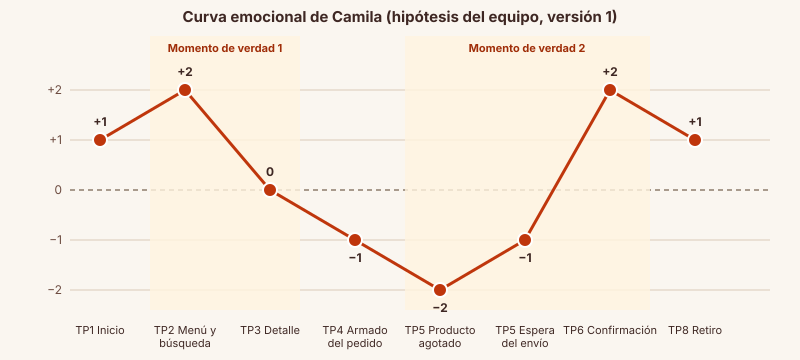

# Análisis de usuario y experiencia (Actividad 1)

Producto: **CaféU 2.0**, aplicación web para consultar el menú de la cafetería universitaria, armar un pedido y retirarlo a una hora elegida.

## 1. Persona usuaria y contexto de interacción

| Aspecto | Descripción |
|---|---|
| Persona (ficticia, basada en el caso) | **Camila**, 20 años, estudiante de quinto semestre de Software en la UTA. |
| Objetivo | Pedir su café y algo de comer sin hacer fila y retirarlos justo cuando sale de clase. |
| Contexto | Entre dos clases, con 15 a 20 minutos libres, de pie, con una mano ocupada, desde el celular. |
| Dispositivo y red | Teléfono Android de pantalla pequeña (360 px de ancho). Los datos móviles y el Wi‑Fi del campus son variables. |
| Frustraciones | Hacer fila, que se agote lo que quería, no saber si el pedido quedó registrado y equivocarse al tocar. |
| Necesidades | Encontrar rápido un producto, ver el total antes de confirmar, corregir errores sin perder el pedido y recibir una confirmación clara. |
| Usuarios con necesidades específicas | Personas que navegan con teclado o lector de pantalla, con baja visión o con movilidad reducida. Por eso la accesibilidad es un requisito (RNF-02). |

## 2. Touchpoints

Se identifican ocho puntos de contacto, siete en pantalla y uno presencial (el retiro).

| # | Touchpoint | Canal | Qué hace la persona | Qué necesita |
|---|---|---|---|---|
| TP1 | Inicio de CaféU | Pantalla | Abre la aplicación y entiende qué puede hacer. | Un mensaje claro y acceso directo al menú. |
| TP2 | Menú y búsqueda | Pantalla | Revisa productos, filtra y escribe lo que quiere. | Que la búsqueda no distinga tildes ni mayúsculas. |
| TP3 | Detalle y disponibilidad | Pantalla | Mira precio, descripción y estado del producto. | Ver si está agotado y recibir alternativas. |
| TP4 | Armado del pedido | Pantalla | Elige la cantidad, revisa el total, quita lo que no quiere. | Controles grandes, total siempre visible, poder deshacer. |
| TP5 | Datos de retiro y confirmación | Pantalla | Escribe su nombre, elige la hora y envía el pedido. | Errores junto al campo y una espera con estado visible. |
| TP6 | Confirmación | Pantalla | Lee el número de pedido y el resumen. | Un estado inequívoco que pueda mostrar en el mostrador. |
| TP7 | Cambio o cancelación | Pantalla | Cambia la hora o cancela el pedido. | Ver el resultado y poder restaurar. |
| TP8 | Retiro en la cafetería | Presencial | Muestra el número y recoge el pedido. | Que el pedido esté listo a la hora indicada. |

## 3. Momentos de verdad

| Momento | Descripción | Por qué decide la experiencia |
|---|---|---|
| **MV1. Encontrar lo que quiere** (TP2 y TP3) | Camila escribe "cafe" y espera ver el café americano. | Si no lo encuentra en segundos, abandona la aplicación y vuelve a la fila. |
| **MV2. Saber que el pedido quedó registrado** (TP5 y TP6) | Camila presiona "Confirmar pedido" y espera una respuesta. | Si hay un error sin salida o una espera sin explicación, no confía en el sistema aunque el resto funcione. |

## 4. Curva emocional

La curva es una hipótesis del equipo para el recorrido de Camila con la versión 1. Se contrasta con la satisfacción medida en las pruebas (SEQ y SUS) en `evaluacion/`.

Escala: de −2 (muy negativa) a +2 (muy positiva).

| Etapa | Emoción | Puntuación | Motivo |
|---|---|---|---|
| TP1 Inicio | Curiosidad | +1 | La pantalla explica qué hacer y ofrece "Ver menú". |
| TP2 Menú y búsqueda | Alivio | +2 | Encuentra el producto con una sola palabra. |
| TP3 Detalle | Duda | 0 | Debe elegir la cantidad y no sabe si el producto sigue disponible. |
| TP4 Armado del pedido | Confusión leve | −1 | Tras agregar cambia de pantalla y debe orientarse de nuevo. |
| TP5 Producto agotado al confirmar | Frustración | −2 | El envío se detiene y debe decidir cómo continuar. |
| TP5 Espera de envío | Ansiedad | −1 | No sabe cuánto tarda, aunque puede cancelar el envío. |
| TP6 Confirmación | Satisfacción | +2 | Ve el número de pedido y el resumen. |
| TP8 Retiro | Tranquilidad | +1 | Muestra el número y retira sin fila. |

Las caídas más profundas coinciden con los dos momentos de verdad, por eso el diseño y las pruebas se concentran en ellos.

## 5. Matriz de problemas, heurísticas de Nielsen y principios de Gestalt

Los problemas salen del caso planteado (visibilidad de mensajes, selección de cantidades, búsqueda de productos, eliminación accidental y recuperación de errores) y de los riesgos que se identifican al recorrer el flujo.

| ID | Problema | Heurística de Nielsen | Principio de Gestalt | Cómo lo aborda la versión 1 | Se verifica en |
|---|---|---|---|---|---|
| P-01 | Los mensajes de confirmación y de error pasan desapercibidos. | 1. Visibilidad del estado del sistema | Figura y fondo | Mensajes con color, texto y borde; los errores reciben el foco y se anuncian a lectores de pantalla. | RF-05, RNF-02 |
| P-02 | La selección de cantidades es incómoda en pantalla táctil. | 5. Prevención de errores · 6. Reconocer en lugar de recordar | Proximidad | Selector con botones − y + agrupados, de 46 px, que se deshabilitan en los límites (1 a 9). | RF-03 |
| P-03 | La búsqueda no encuentra "cafe" si el producto se llama "Café". | 2. Relación con el mundo real · 7. Flexibilidad y eficiencia | Pregnancia (simplicidad) | Búsqueda normalizada que ignora tildes y mayúsculas. | RF-02 |
| P-04 | Se elimina un producto por accidente. | 3. Control y libertad del usuario | Proximidad | El botón "Quitar" va separado del selector y ofrece "Deshacer". | RF-04 |
| P-05 | Un producto se agota mientras se confirma y no hay salida. | 9. Ayudar a reconocer, diagnosticar y recuperarse de errores | Figura y fondo | Mensaje de error con dos caminos: quitar el producto o cambiarlo por otro. | RF-05 |
| P-06 | El formulario no explica qué dato falta. | 5. Prevención de errores · 9. Recuperación de errores | Proximidad | Mensaje junto al campo, resumen de errores con enlaces y foco en el primer problema. | RF-05 |
| P-07 | Se cancela un pedido confirmado sin querer. | 3. Control y libertad del usuario | Cierre | Diálogo de confirmación y opción "Restaurar pedido". | RF-06 |
| P-08 | Los nombres de navegación se repiten ("Mi pedido" aparece varias veces). | 4. Consistencia y estándares | Similitud | Barra de pestañas y botón superior con el mismo patrón. Se revisa en la evaluación heurística. | Evaluación heurística |
| P-09 | No se puede usar solo con teclado o con lector de pantalla. | 7. Flexibilidad y eficiencia · Accesibilidad | Continuidad | Foco visible, enlace "Saltar al contenido", orden lógico y región `aria-live`. | RNF-02 |

## 6. De dónde sale este análisis

- Caso práctico de la prueba (CaféU 2.0) y el prototipo v3 de APE 4, que es la base de la versión 1.
- Observación del flujo completo de la aplicación en el navegador.
- Las evidencias reales de uso se agregan en `evaluacion/` y `evidencias/` después de las pruebas.
