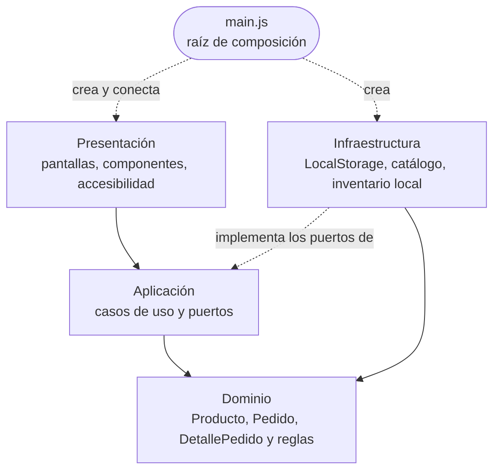
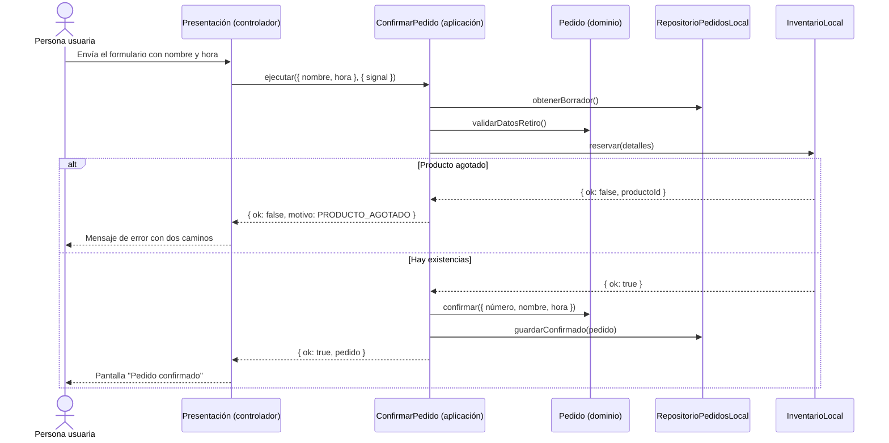

# Arquitectura de software (Actividad 3)

CaféU está organizado en cuatro capas: **presentación**, **aplicación**, **dominio** e **infraestructura**. Se implementa con JavaScript moderno (módulos ES), sin frameworks ni herramientas de compilación, para que cualquier integrante pueda leer y ejecutar el código sin instalar nada más que Node.

## 1. Las cuatro capas

| Capa | Carpeta | Responsabilidad | Contenido |
|---|---|---|---|
| Presentación | `src/presentation/` | Mostrar la interfaz, recibir eventos y gestionar foco y anuncios. | `index.html`, `estilos.css`, `controlador.js`, `estadoUI.js`, `accesibilidad.js`, `vistas/` (8 pantallas) y `componentes/` (botón, mensaje, campo, selector de cantidad, tarjeta de producto, etc.). |
| Aplicación | `src/application/` | Orquestar cada acción de la persona usuaria, sin saber cómo se guarda ni cómo se dibuja. | Un caso de uso por archivo (`listarMenu`, `agregarAlPedido`, `cambiarCantidad`, `quitarDelPedido`, `deshacerQuitar`, `confirmarPedido`, `resolverConflictoStock`, `cambiarHoraRetiro`, `cancelarPedido`, `restaurarPedido`, `reiniciarDemostracion`, etc.), `puertos.js` y `dto.js`. |
| Dominio | `src/domain/` | Las reglas del negocio, sin depender de nada externo. | `Producto`, `Pedido`, `DetallePedido`, `reglas.js` (cantidad de 1 a 9, horas de retiro, validaciones), `busqueda.js` (normalización sin tildes) y `errores.js`. |
| Infraestructura | `src/infrastructure/` | Los detalles técnicos: dónde se guardan los datos y cómo se consulta el inventario. | `almacenamiento.js` (envoltorio de `localStorage` con respaldo en memoria), `repositorioProductosLocal.js`, `repositorioPedidosLocal.js`, `inventarioLocal.js` y `catalogoInicial.js`. |

## 2. Cómo se explican las dependencias

La regla es que **las dependencias apuntan hacia el dominio**:

- La **presentación** solo conoce la **aplicación**. Llama casos de uso y recibe datos simples (DTO). Nunca importa entidades del dominio ni infraestructura.
- La **aplicación** solo conoce el **dominio**. Cuando necesita guardar datos o consultar el inventario, usa **puertos** (`RepositorioProductos`, `RepositorioPedidos` y `ServicioInventario`, definidos en `application/puertos.js`) y no sabe qué hay detrás.
- El **dominio** no depende de ninguna capa. No usa `window`, `document` ni `localStorage`.
- La **infraestructura** depende hacia adentro: sus clases **extienden los puertos** de la aplicación y construyen entidades del dominio. Así, cambiar `localStorage` por un API real solo exige escribir otro adaptador, sin tocar los casos de uso ni las pantallas.
- Solo `presentation/main.js` conoce a la infraestructura: es la **raíz de composición**, el único lugar donde se crean los adaptadores y se inyectan en los casos de uso.

En el esquema de la prueba la infraestructura aparece al final de la cadena (presentación, aplicación, dominio, infraestructura). Eso describe el camino de una petición hasta los datos. La dirección de las dependencias de código se invierte en el último paso mediante los puertos, y es lo que permite probar la aplicación sin navegador.

Esta regla se comprueba automáticamente en [`tests/arquitectura.test.js`](../tests/arquitectura.test.js): si un archivo importa una capa que no le corresponde, la prueba falla.

## 3. Ejemplo: confirmar un pedido

## 4. Decisiones y su justificación

| Decisión | Motivo |
|---|---|
| Módulos ES sin compilador | Menos herramientas, ejecución con un servidor estático y código legible en el navegador. |
| Casos de uso como clases pequeñas, una por archivo | Cada acción de la persona usuaria tiene un nombre y un lugar; es fácil de probar y de repartir en commits. |
| Los casos de uso devuelven `{ ok, motivo }` en lugar de lanzar errores | Los fallos esperados (datos inválidos, producto agotado) forman parte del flujo normal y la interfaz decide cómo mostrarlos. |
| DTO entre aplicación y presentación | La interfaz no puede modificar entidades por accidente. |
| `localStorage` detrás de un puerto | Cumple la persistencia pedida y deja abierta la opción de un API. |
| Inventario local | Reproduce el conflicto "se agotó mientras confirmabas" sin necesidad de un servidor. Tarda 1,3 s y se puede cancelar con `AbortController`. |
| Presentación con componentes reutilizables | Botón, mensaje, campo, selector de cantidad y tarjeta se usan en varias pantallas con el mismo marcado accesible. |

## 5. Mobile First, accesibilidad y teclado

- `estilos.css` parte del diseño para 360 px de ancho y se adapta a pantallas mayores. Los controles táctiles miden 44 a 46 px.
- HTML semántico: `header`, `main`, `nav`, `form`, `label`, `fieldset`, `dialog`, listas ordenadas para el progreso.
- Foco visible con `:focus-visible`, enlace "Saltar al contenido", foco movido a los mensajes de error y al título de cada pantalla.
- Región `aria-live` para anunciar cambios de pantalla y resultados; los errores usan `role="alert"`.
- Todo el flujo se recorre con `Tab`, `Enter` y `Esc` (el diálogo de cancelación se cierra con `Esc`).

## 6. Pruebas

Las pruebas usan el ejecutor integrado de Node (`node:test`) y se lanzan con `npm test`. Cubren las reglas del dominio, los casos de uso completos con persistencia en memoria, la persistencia y la regla de dependencias. La matriz [`trazabilidad.md`](trazabilidad.md) relaciona cada requisito con su prueba.

## 7. Limitaciones

- No hay servidor ni base de datos: los datos viven en el navegador de cada persona.
- El inventario es determinista: el producto con pocas unidades siempre se agota en el primer intento de confirmación.
- Las pruebas automatizadas cubren la lógica; la interfaz se comprueba con las evaluaciones de `evaluacion/`.
