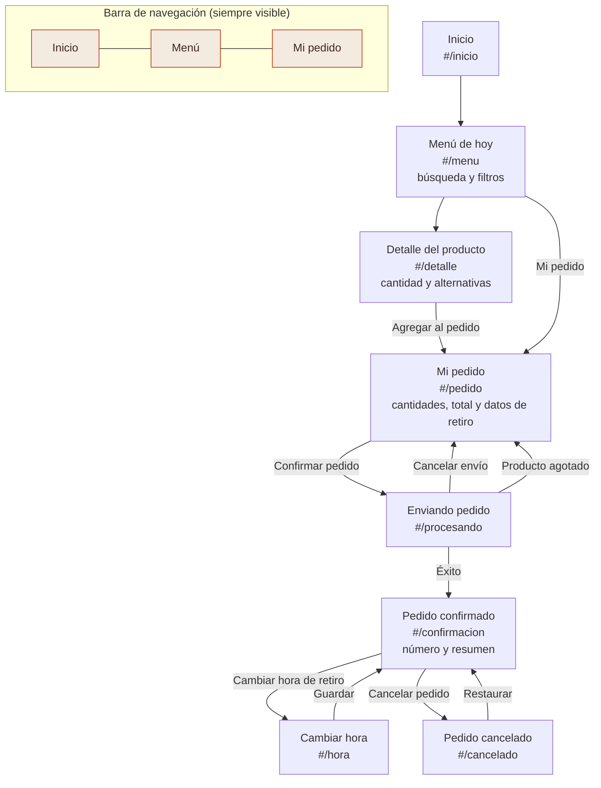

# Sitemap (Actividad 2)

CaféU tiene ocho pantallas. Tres de ellas son accesibles siempre desde la barra inferior (Inicio, Menú y Mi pedido); las demás aparecen dentro del flujo del pedido.

## Rutas

| Pantalla | Ruta | Contenido principal | Requisitos |
|---|---|---|---|
| Inicio | `#/inicio` | Mensaje de bienvenida, acceso al menú, horario de atención. | RF-01 |
| Menú de hoy | `#/menu` | Buscador, filtros por categoría, tarjetas de producto. | RF-01, RF-02 |
| Detalle del producto | `#/detalle` | Descripción, estado, selector de cantidad, alternativas si está agotado. | RF-01, RF-03 |
| Mi pedido | `#/pedido` | Líneas con cantidad, total, quitar y deshacer, nombre y hora de retiro, conflicto de stock. | RF-03, RF-04, RF-05 |
| Enviando pedido | `#/procesando` | Estado de espera con opción de cancelar el envío. | RF-05 |
| Pedido confirmado | `#/confirmacion` | Número de pedido, resumen, acciones de cambiar hora y cancelar. | RF-05, RF-06 |
| Cambiar hora | `#/hora` | Selector de nueva hora con validación. | RF-06 |
| Pedido cancelado | `#/cancelado` | Aviso de cancelación y opción de restaurar. | RF-06 |
