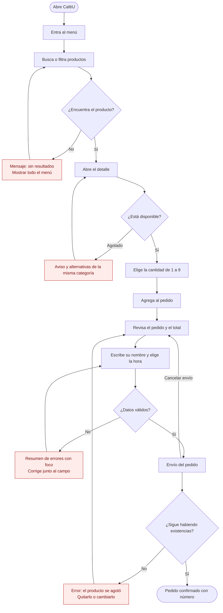
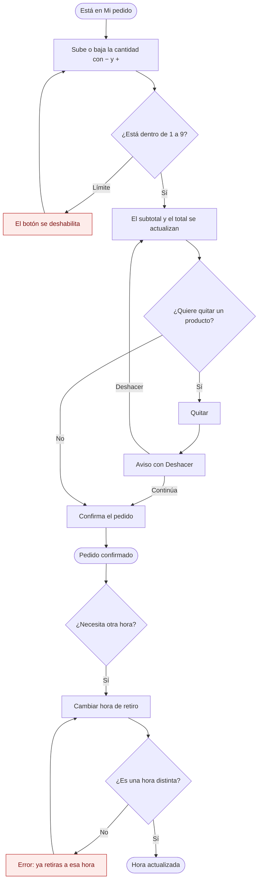
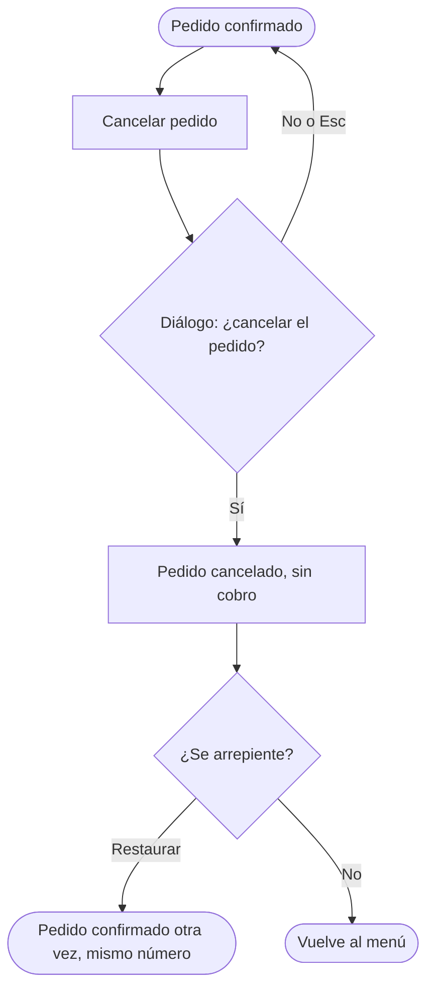

# User flow (Actividad 2)

Tres flujos de la persona usuaria: **compra**, **modificación** y **cancelación**. Los rombos son decisiones; los bloques rojos son errores con camino de recuperación.

## 1. Compra (T1 y parte de T3)

## 2. Modificación (T2 y T3)

## 3. Cancelación (T3)

